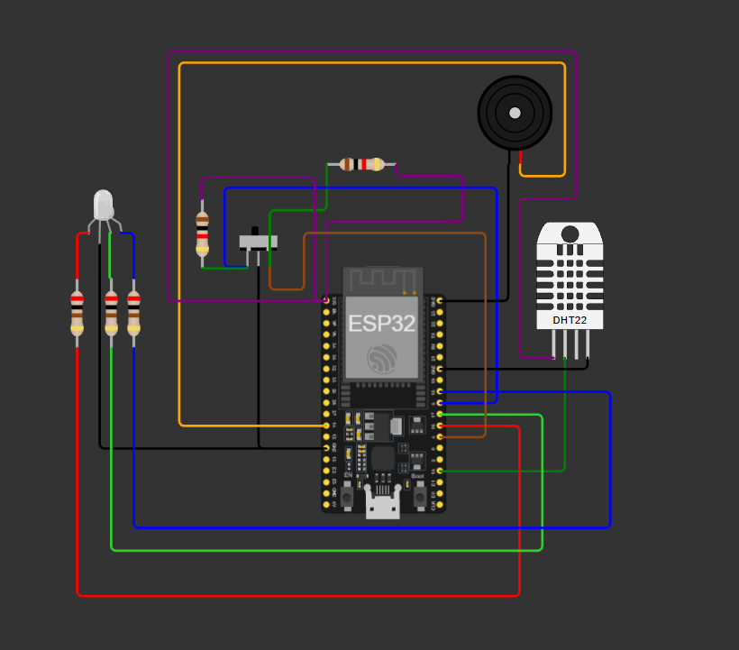

# ESP32 Humidity and Temperature Monitor

Firmware for an ESP32 that monitors temperature and humidity with a DHT22 and gives instant visual and audible feedback: an RGB LED shows the humidity band and a buzzer sounds when it gets too humid. Interrupt-driven slide-switch overrides can take over the LED on demand.

Built in 2025 as a second-year university project and simulated in Wokwi. It's an earlier piece of work, kept here as part of my embedded and IoT background.

## Circuit

*Simulated wiring in Wokwi: DHT22 on pin 15, buzzer on 14, RGB LED on 16, 17 and 18, slide switch on 5 and 4.*

## How it works

- **Monitoring:** the DHT22 is polled every 2 s without blocking (`millis()` timing, no `delay()`). Readings go to the serial monitor, and if a read returns NaN the last good values are reused
- **Feedback:** humidity selects the LED colour through PWM, and the buzzer sounds at 80% and above
- **Overrides:** two switch pins are attached as falling-edge interrupts (`IRAM_ATTR` handlers with a 250 ms debounce). Each one sets a flag that the main loop picks up, which keeps the handlers short. The override shows cyan or pink for 2 s and silences the buzzer, then monitoring resumes straight away

| Humidity | LED | Buzzer |
|---|---|---|
| 90%+ | Purple | On |
| 80 to 89% | Red | On |
| 70 to 79% | Orange | Off |
| 60 to 69% | Yellow | Off |
| 50 to 59% | Green | Off |
| 40 to 49% | Blue | Off |
| 30 to 39% | White | Off |
| below 30% | Off | Off |

## Hardware

ESP32 DevKit, DHT22, common-cathode RGB LED with 200 ohm resistors, buzzer, slide switch with 1 k pull-ups.

| Part | Pin |
|---|---|
| DHT22 data | 15 |
| Buzzer | 14 |
| RGB LED (R, G, B) | 16, 17, 18 |
| Slide switch (right, left) | 5, 4 |

## Run it

Load `diagram.json` and `sketch.ino` into a new Wokwi ESP32 project. The only library is *DHT sensor library*.
